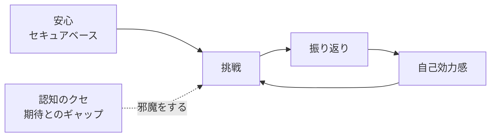
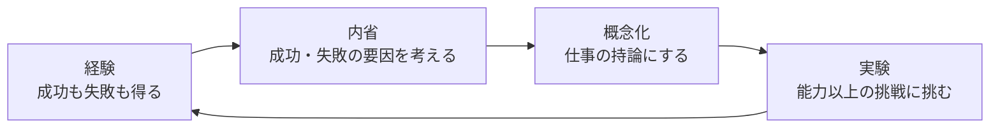
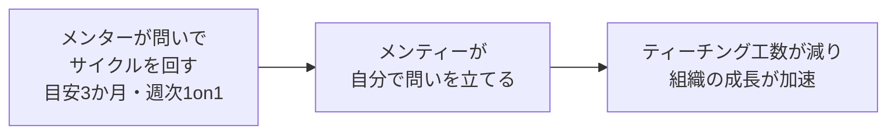
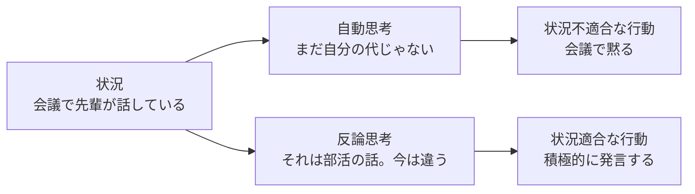

# 育成研修まとめ

経験学習 / 認知行動療法 / リアリティーショック / ジョブクラフティング

メンター・マネージャーとして、何を意識し、明日から何をやるか

---

## 4回の全体像

<div class="timeline">
  <div class="step"><strong>経験学習</strong><span>挑戦と振り返りを回して成長角度を上げる</span></div>
  <div class="step"><strong>認知のクセ</strong><span>成長を止める固定観念をほどく</span></div>
  <div class="step"><strong>リアリティーショック</strong><span>期待と現実のギャップで潰れないようにする</span></div>
  <div class="step"><strong>ジョブクラフティング</strong><span>やらされ仕事を、自分の手で面白くする</span></div>
</div>

---

## 4回に共通する土台



- 成長の燃料は **自己効力感**（自分はできる・できるようになるという自信）
- 安心がないと挑戦できない。挑戦がないと振り返る素材がない

---

## 自己効力感の4つの源泉

4回すべてに出てくる、いちばん大事な理論

<div class="matrix">
  <div><h4>1. 達成経験</h4><p>できないと思っていたことができた、という成功体験。</p></div>
  <div><h4>2. 社会的説得</h4><p>自分の能力を他者から言葉で認められる。</p></div>
  <div><h4>3. 代理体験</h4><p>「あの人ができるなら自分もできるかも」と思える。</p></div>
  <div><h4>4. 感情的状態</h4><p>心身のコンディション。疲れているときは休む、寝る。</p></div>
</div>

自己肯定感（ありのままでいい = be good）と自己効力感（できるようになる = to be good）は別物

---

# 第1部　経験学習

成長角度の速い人を育てる方法

---

## 経験学習モデル

自分の能力以上の仕事に挑戦し、徹底して振り返ることで、学びを自分のものにする（コルブの経験学習モデル）



挑戦だけでも、振り返りだけでもダメ。**両方を速く回す** ほど成長が速い

---

## 片側だけ回すとどうなるか

| | 挑戦だけ | 振り返りだけ |
| --- | --- | --- |
| 典型的なセリフ | 「コツは…センス？」 | 「試してみた？」「まだです」 |
| 起きること | 同じ失敗を繰り返す。成功を再現できない | 机上の空論で終わる |
| 組織への影響 | 説明できないので後輩に教えられない | 新しい振り返りの素材が入らない |

---

## 振り返りを促す5つの問い

| 問い | 例 |
| --- | --- |
| ① 差分分析 | 上手くいく時といかない時の差はどこにありそう？ |
| ② 成功要因分析 | 今回は何を気をつけたから上手くいったのかな？ |
| ③ 他者分析 | それが得意な人は、どこに気をつけていそう？ |
| ④ コツ説明 | この仕事のコツを3つ挙げるとしたら？ |
| ⑤ 他者説明 | 後輩が来たら、どう説明する？ |

返ってきた言葉は「つまり、◯◯ということかな？」と言語化を手伝う

---

## 挑戦を促す問いかけ

| 観点 | 例 |
| --- | --- |
| ① 進捗自覚 | 1か月前はできなかったけど、今は完璧にできてるね |
| ② 貢献自覚 | ◯◯さんがいなかったら出せなかった成果。ありがとう |
| ③ 強み自覚 | ◯◯という強みは、チームで一番だと思う |
| ④ 次の挑戦 | 強みを活かして、次はどんな挑戦をしてみる？ |
| ⑤ 視座を上げる | もしあなたがリーダーだったら、何をしてみる？ |

0点か100点かではなく、**50点が60点になった進歩** を大切にする

---

## メンターの役割は「補助輪」



簡易版は4ステップ：①経験の振り返り → ②パッケージ化（コツにまとめる）→ ③勇気づけ → ④挑戦促進

---

## 陥りがちな間違い

<div class="matrix">
  <div><h4>課題だけを振り返る</h4><p>「できない自分」ばかり見るとゴーレム効果を自分にかける。失敗だけでは学びが半分。反省はしても罪悪感はいらない。</p></div>
  <div><h4>過剰なティーチング</h4><p>質問せずに答えを渡すと、咀嚼していないので使えない。答えを待つ姿勢も育つ。</p></div>
  <div><h4>過剰なコーチング</h4><p>質問だけで何も教えないと、新しい材料がなく考えようがない。</p></div>
  <div><h4>圧クイズ</h4><p>相手を試すような問い。問いは自分と相手の「間」に置いて一緒に考える。</p></div>
</div>

---

## 振り返りの3つの前提

| ✕ | ◯ | 言い換え |
| --- | --- | --- |
| 過去 | 未来 | なんでできないの？ → どうしたらできる？ |
| 人格 | 行動 | なんで君はできないの？ → 何がコツなんだろう？ |
| 正解 | 仮説 | 絶対の正解はこれ → これが自分なりのコツかも？ |

教えるときは「自分の経験の範囲では〜」と前置きする。メンターのインプットも100%正しいわけではない

---

## メンターがやるとよい3つ

<div class="timeline">
  <div class="step"><strong>① 一緒に他者分析</strong><span>一番得意な人は何に気をつけている？聞きに行ってもらう</span></div>
  <div class="step"><strong>② ファインプレー分析</strong><span>細かい良い言動を褒めてから、成功要因を聞く</span></div>
  <div class="step"><strong>③ 学んだこと発表会</strong><span>週に1つ、互いのいちおしの学びを共有する</span></div>
</div>

- 他者分析は、自分が教えられない能力でもトップレベルに鍛えられる
- 発表会はメンター自身の率先垂範。学習姿勢そのものを伝える

---

## 表層学習と深層学習

（松尾睦『仕事のアンラーニング』より）

| | 表層学習 | 深層学習 |
| --- | --- | --- |
| 中身 | 仕事の能力が上達する | 仕事の信念・価値観が変わる |
| 例 | 提案が上手くなる | 一番を譲ってでもメンバーを活かす |
| 比喩 | Ver1.0 → Ver1.1 | Ver1.0 → Ver2.0 |

すごい人に会ったら、アウトプットのコツだけでなく **「何を大切に仕事をしているか」**（仕事のOS）を聞く

---

# 第2部　認知のクセ

認知行動療法で、成長を止める固定観念をほどく

---

## リーダーはまず自分を動かす

<div class="diagram">
  <div class="node">人生の価値観<small>自分が本当にしたいこと</small></div>
  <div class="arrow">×</div>
  <div class="node">仕事の真価<small>世の中が本当に求めていること</small></div>
  <div class="arrow">=</div>
  <div class="node">リーダーシップの源泉<small>ビジョン</small></div>
</div>

- 価値観は「いつから大切にしている？」「一番怒った経験は？」など複数の角度から掘る
- 正解は、**自分の心が動くかどうか**

---

## なぜ人は変わらないのか

過去の経験から生まれた固定観念が、成長を止める根本原因になっていることがある

| 過去の経験 | 固定観念 | 問題行動 |
| --- | --- | --- |
| ずっと優等生だった | アウトプットは常に完璧でなければ | 相談が遅く、納期ギリギリになる |
| 部活で「出しゃばるな」と怒られた | 先輩が話す場では黙るべき | 会議を仕切らない |
| 圧倒的な努力で逆境を越えた | 努力しない人はダメ | 周りに冷たく、怖がられる |

新人だけでなく、成熟したマネージャーにも同じことが起きる

---

## コダワリとトラワレ

<div class="quote-panel">今まで自分を成功させてくれたものが、次のステージでは足かせになる。</div>

- 認知フレームは武器にも足かせにもなる。そして全員が持っている
- 役割が変わると勝ちパターンが通用しなくなる（コンピテンシー・トラップ）
  - エース：誰よりも成果を出す
  - ミドル：人を活かして組織の成果を出す
  - トップ：正解のない中で、嫌われても決断する
- 組織の成長につながらないコダワリは、トラワレ

---

## 固定観念をほどく構造



過去の出来事は変えられないが、そこから生まれる **自動思考** は補正できる

---

## ほどき方のスタンス

- 「どうしてこの人はいつもこうなんだ」ではなく、**どこで歪みが生じているか** をフラットに分析する
- 問題行動の裏には自己防衛がある。**何から守ろうとしているか** を特定する

| 型 | 問い |
| --- | --- |
| 停止型 | 誰に何と言われるのが怖い？誰に怒られると思っている？ |
| 過剰型 | 誰にどう認められたい？誰を見返したい？ |

---

## 会話の流れ

<div class="timeline">
  <div class="step"><strong>1. 行動</strong><span>もったいないと思う行動を伝える</span></div>
  <div class="step"><strong>2. 感情</strong><span>そのとき何が心に浮かんでいる？</span></div>
  <div class="step"><strong>3. 過去</strong><span>同じことを思った過去の場面は？</span></div>
  <div class="step"><strong>4. 現実</strong><span>今それを咎める人はいる？</span></div>
  <div class="step"><strong>5. 反論</strong><span>次にその考えが出たら、どう反論する？</span></div>
</div>

自動思考と反論を **本人に言語化してもらう** と、自分を俯瞰できるようになる

---

## 解除のテクニック

<div class="matrix">
  <div><h4>解体リフレーミング</h4><p>「良いマイクロマネジメントと悪いものの違いは？」と言葉を分解し、善悪のざっくりした捉え方を外す。</p></div>
  <div><h4>メリデメ俯瞰</h4><p>その信念のメリット・デメリット、上手くいく場面と邪魔になる場面を並べる。</p></div>
  <div><h4>否定しない誘導</h4><p>「カッコよく生きたいなら、この仕事にどう取り組む？」と相手のアイデンティティに沿って問う。</p></div>
  <div><h4>集中対処期間</h4><p>2〜3か月は1つだけに絞る。完璧ではなく、発生確率の減少を見る。</p></div>
</div>

---

## 組織にもトラワレがある

- 組織も人と同じく、認知フレームで状況に合わなくなる
  - 現実歪曲の病：「うちの社員はみなこうだ」「これは正しい」
  - 外部環境軽視の病：「私たちは特別だから大丈夫」
- 外部環境への適応より、内部論理への最適化が進んでしまう

<div class="quote-panel">「我々がどうありたいか」ではなく「時代や市場にどんな変化があるか」を問い続ける。</div>

---

# 第3部　リアリティーショック

新しく加わった人が陥る、期待と現実のギャップ

---

## リアリティーショックとは

組織に新しく加わったメンバーに起きる、想定していた期待と現実のギャップ

- 「もっと早く活躍できると思っていたのに」という **焦燥感**
- 「自分はできる方だと思っていたのに」という **劣等感**
- 新卒だけでなく、中途入社、昇格したて、新任マネージャー、事業責任者にも起きる
- 過渡期に必ず訪れるもの

---

## 潰れるほどのストレスは逆効果

<div class="diagram">
  <div class="node">安心<small>セキュアベース</small></div>
  <div class="arrow">⇄</div>
  <div class="node">挑戦<small>大きな挑戦には大きな安全基地が要る</small></div>
</div>

- メンタルが壊れた状態では挑戦できない。そこに圧をかけると恐怖で「人」に意識が向く
- 周りに期待されていないと感じると、本当にパフォーマンスが落ちる（ゴーレム効果）

---

## なぜ見落とすのか

<div class="matrix">
  <div><h4>忘れてしまっている</h4><p>自分が当初感じていた悩みを、もう思い出せない。</p></div>
  <div><h4>生存者バイアス</h4><p>「一回死線をくぐれ」はたまたま生き残っただけかもしれない。「にも関わらず」と「のおかげ」を取り違えない。</p></div>
  <div><h4>年次の離れたメンター</h4><p>5年目以上のメンターがつくと、新人がパニックになりやすい。</p></div>
  <div><h4>張り切りすぎるメンター</h4><p>2〜3年目は理想の社員像を押し付けがち。</p></div>
</div>

---

## 4つの典型パターンと処方箋

| ストレス | 中身 | 処方箋 |
| --- | --- | --- |
| ① モニター | 一挙手一投足を評価されていると感じる。指摘が多すぎて動けない | 仲間だと宣言する。直すことを1つに絞る |
| ② ロールモデル | 先輩や同期との差に落ち込む | 自分の過去の失敗を話す。今も学習中だと示す |
| ③ 無能感 | 思ったより貢献できない | 無能感を覚える場を減らし、強みを出せる場を作る |
| ④ 下っ端 | 地味な仕事ばかりだと感じる | リフレーミングで仕事の価値を再発見してもらう |

---

## ① モニターストレスへの対応

- 「自分は評価者である前に、◯◯さんの仲間です」と **言葉にして** 伝える
- 指摘が多いときは「全部一度に直すのは無理。一番大事なことだけに絞ろう」
- やり方は押し付けず、相対化して渡す

| ✕ 押し付け | ◯ 提示 |
| --- | --- |
| 普通に考えてこっちでしょ | そういうやり方もあるね。自分ならこうするかな |

<div class="quote-panel">一番大事なのは「こいつを試してやろう」という気持ちを持たないこと。</div>

---

## ②③ ロールモデル・無能感への対応

- 最悪なのは「自分は天才なので」という自己神格化。代理体験の逆を生む
- 「自分も1年目はこういう失敗をした」「まだ学び続けている」と見せる
- 出ても出なくてもいい会議に入れて、無能感を味わわせない
- 強みを発揮できそうな部分を事前に作って話を振る

```text
この部分は◯◯さんが調べてくれて、いまチームで一番詳しいんですよ
```

本人が一番手応えを感じているタイミングで「さっきの、すごく良かったね」と声をかける

---

## ④ 下っ端ストレスとリフレーミング

ポジティブシンキングは事実から目をそらす。リフレーミングは **別の解釈を追加する**

| 仕事 | リフレーミングの例 |
| --- | --- |
| データ集計 | 分析は将来も使う。関数のプロになる訓練になる |
| 顧客対応 | 一次情報に触れていることが、企画の質を決める最大の強みになる |
| 社内イベント幹事 | 他チームに名前を覚えてもらえば、後の仕事が圧倒的に楽になる |

押し付けず「こういう解釈もできるかも」で、相手起点のメリットを示す

---

## 学習目標で立て直す

（キャロル・ドゥエックの達成目標理論）

| 業績目標 | 学習目標 |
| --- | --- |
| 成果を出せば褒められる。競争に勝てる | 挑戦すると新しい学びが得られる |
| 否定的な評価を避けたい | 学びがあること自体が面白い |

- 長く成果を出し続けるのは学習目標を持つ人
- 沼にはまったら「今回、新しく得られた学びは？」と聞き、学習量 = 成功確度に目を向けてもらう
- 前提として、悩みは消させるのではなく傾聴で特定する。言えていないことがありそうなら、自分から先に自己開示する

---

# 第4部　ジョブクラフティング

やらされ仕事を、自分の手で面白くする

---

## なぜ今ジョブクラフティングか

- 働き方改革とリモートワークで、「いいからやれ」のマネジメントが取りにくくなった
- 外からのプレッシャーが減り、**自分で自分を鼓舞する** 必要が出てきた
- 主体的に取り組むかどうかで、個人と組織の成長に大きな差がつく

<div class="diagram">
  <div class="node">面白い仕事</div>
  <div class="arrow">←</div>
  <div class="node">面白くする仕事<small>ここが腕の見せ所</small></div>
  <div class="arrow">　</div>
  <div class="node">面白くない仕事<small>単純作業・押し付け・意味不明</small></div>
</div>

---

## 3種類のクラフティング

<div class="matrix">
  <div><h4>① タスク</h4><p>作業の中身や範囲を主体的に捉え直す。「やり方を変えてはいけない」と誰が決めた？</p></div>
  <div><h4>② 関係</h4><p>仕事相手との関係を捉え直す。相手との関係を自分で決めつけていない？</p></div>
  <div><h4>③ 認知</h4><p>仕事の意味を捉え直す。この仕事は誰にどんな喜びを届けている？</p></div>
  <div><h4>共通の土台</h4><p>常に実験する。相手を決めつけない。自分なんか、と自己卑下しない。</p></div>
</div>

---

## ① タスククラフティング

<div class="case">
  <h4>例：テンプレ化した採用面接</h4>
  <p>7割は従来の質問、3割を実験的な質問にした。本音に迫れる質問が見つかり、他の候補者にも効いた。致命的な失敗を避けた範囲で実験すればいい。</p>
</div>

- どうせやるなら、面接マニュアルを作って「その道の第一人者」になる
- 他部署の人とも 1on1 してはいけないと誰が決めた？ → 社内100人と 1on1
- 「世の中で一番すごい新人ならどうする？」と **架空のベンチマーク** を置く
- 退屈するほどやっているなら、一番詳しいのは自分

---

## ② 関係クラフティング

- 不満を1つ持ったら、感謝すべき点を1つ見つける
- 相手を「心ある存在」として見て、対話する。把握すべきは3つ

<div class="timeline">
  <div class="step"><strong>目標</strong><span>相手はいま何を背負い、何に追われている？</span></div>
  <div class="step"><strong>願い</strong><span>事業・組織・人にどうあってほしい？ほしくない？</span></div>
  <div class="step"><strong>好き嫌い</strong><span>何を大切にし、何が許せない？それはなぜ？</span></div>
</div>

- 上司も成長途上の人。部下でも思うことは伝える。そのとき自分の落ち度を先に言う

---

## ③ 認知的クラフティングとやる気の構造

（ToMo 指数。『マッキンゼー流 最高の社風のつくり方』より）

| 直接的動機（上げる） | 間接的動機（下げる） |
| --- | --- |
| 楽しさ：仕事自体が面白い | 感情的圧力：怒られる・失望させる |
| 目的：届けている価値に共感している | 経済的圧力：生活のため |
| 可能性：将来の自己実現につながる | 惰性：なんとなく楽 |

- 石工の話。「食べるため」から「皆の心のよりどころを作っている」まで、同じ作業でも意味が違う
- 「どんな人になりたくて入社した？今の仕事はそこに1mmも役立っていない？」と問う

---

# まとめ

---

## 研修全体から持ち帰ること

<div class="matrix">
  <div><h4>問いを間に置く</h4><p>答えを渡すのでも、試すのでもなく、一緒に考える。過去でなく未来、人格でなく行動、正解でなく仮説。</p></div>
  <div><h4>自己効力感を育てる</h4><p>進歩を言葉にし、等身大の失敗談を話し、強みを出せる場を作る。</p></div>
  <div><h4>行動の裏を見る</h4><p>問題行動の裏には固定観念と自己防衛がある。責めずに、歪みの場所を分析する。</p></div>
  <div><h4>自分も学び続ける</h4><p>メンターの一番の背中は、挑戦と学習を続けている姿勢。</p></div>
</div>

---

## Next Action：メンターとして

| いつ | やること |
| --- | --- |
| 次の 1on1 | 「評価者である前に仲間です」と言葉にして伝える |
| 毎週の 1on1 | 振り返りの5つの問いから1つ選び、最後に「コツを3つにまとめると？」で締める |
| 毎週 | お互いのいちおしの学びを1つずつ共有する |
| 気づいたら | ファインプレーを具体的に褒め、その場で成功要因を聞く |
| 今月 | メンティーが伸ばしたい能力で一番得意な人を一緒に特定し、話を聞きに行ってもらう |
| 今月 | 4つのリアリティーショックのどれに近いか、傾聴して把握する |
| 定期的に | メンティーが面白くないと感じていそうな仕事を1つ選び、リフレーミングを試す |

---

## Next Action：自分自身として

| やること | 問い |
| --- | --- |
| 自分の認知フレームを1つ書き出す | 自分を成功させてきたコダワリで、今トラワレになっているものは？ |
| 自動思考と反論をセットで書く | その考えが出た瞬間に、どう反論する？ |
| 2〜3か月は1つに絞って直す | 今日はできた？発生回数は減った？ |
| 尊敬する人に深層的な他者分析をする | 仕事で何を大切にしていますか？これだけは許せないことは？ |
| 自分の仕事の真価を言語化する | 自分の仕事は、誰にどんな喜びを届けている？ |
| 苦手な相手の3つを把握する | 相手が背負っている目標、願い、好き嫌いは？ |

---

## 意識したいこと

<div class="quote-panel">「なんでできないの？」ではなく「どうしたらできるんだろう？」</div>

- 自分の普通は、相手の普通ではない。やり方は相対化して渡す
- 0点か100点かではなく、進歩を見る。完璧ではなく発生確率の減少を見る
- 教えすぎず、問いすぎず。一度問いを挟んで考える時間を渡す
- 生存者バイアスを疑う。自分が通った道を、相手に強いない
- 安心と挑戦はセット。圧をかける前に、安全基地があるかを確かめる
- 自分のコダワリがトラワレになっていないか、定期的に疑う

---

## 1枚で振り返る

| 回 | 一言で | キーフレーズ |
| --- | --- | --- |
| 経験学習 | 挑戦と振り返りを速く回す | 50点が60点になった進歩を大切に |
| 認知のクセ | 固定観念をほどき、自動思考に反論する | コダワリとトラワレは似て非なるもの |
| リアリティーショック | 期待と現実のギャップに気づき、安心を作る | 試してやろうという気持ちを持たない |
| ジョブクラフティング | タスク・関係・意味を自分で捉え直す | 「それ、誰が決めたんだっけ？」 |
