# pstack の機能と設計思想

AIエージェントを「スロップ量産機」から「エンジニアリングチーム」に変える

---

## 今日話すこと

<div class="timeline">
  <div class="step"><strong>Why</strong><span>pstack が解こうとしている問題</span></div>
  <div class="step"><strong>What</strong><span>poteto-mode・プレイブック・スキル</span></div>
  <div class="step"><strong>How</strong><span>設計・検証・並列化・夜間実行</span></div>
  <div class="step"><strong>Principles</strong><span>24の原則と設計思想</span></div>
</div>

---

## pstack とは

Cursor の poteto 氏が日常で使っているスキル群を公開したプラグイン

- 作者は Meta・Netflix・Cursor で大規模コードに関わり、React Compiler を作る React コアチームのメンバー
- Cursor 向けに作られ、Claude Code でも `/plugin install pstack@cursor-plugins` で入る
- 中身は Markdown のスキル（`SKILL.md`）、プレイブック、2種類のサブエージェント
- 本スライドは v0.15.46 時点の内容

---

## 出発点：AIは「スロップ」を書きすぎる

<div class="quote-panel">if you want to go fast, go deep first.<br>速く進みたいなら、まず深く潜れ。</div>

- 量産されたコードは、レビューと保守のコストとして人間に返ってくる
- 「20人のスロップ職人のように出荷したくない」
- 目標は LOC の最大化ではなく、**少なく、質の高いコード**

---

## 2つの約束

<div class="matrix">
  <div><h4>Less, but better</h4><p>書く量を減らす。削除と最小差分に寄せ、検証済みのコードだけを残す。</p></div>
  <div><h4>Fearless parallelism</h4><p>1体のエージェントを深く信頼できれば、複数体を安心して並列に走らせられる。</p></div>
  <div><h4>Any model</h4><p>モデルごとの得意を組み合わせる。審査やレビューは別ベンダーのモデルに任せる。</p></div>
  <div><h4>Make it yours</h4><p>フォークして育てる前提。自分専用の mode やルールを作る仕組みが入っている。</p></div>
</div>

---

## 深さが並列化を可能にする

並列数を増やす前に、1体あたりの「信頼できる度合い」を上げる

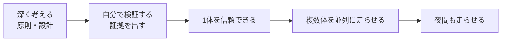

検証なしで並列化すると、未検証の仕事が並列数ぶん増えるだけ

---

## 全体像

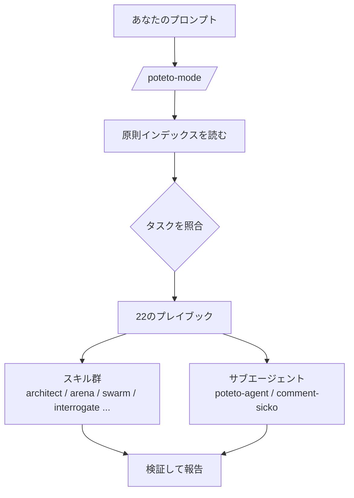

---

## 3つの構成要素

| 層 | 役割 | 例 |
| --- | --- | --- |
| Mode | 入口。タスクを読み、手順を選ぶ | `/poteto-mode` |
| Playbook | タスク種別ごとの決まった手順 | Bug fix, Feature, Perf |
| Skill | 手順の中で呼ばれる専門技能 | `/architect`, `/interrogate` |
| Principle | すべての判断の根拠になるルール | Laziness Protocol |
| Agent | 委譲先のサブエージェント | `poteto-agent` |

---

## 入口は `/poteto-mode` だけでいい

```text
/poteto-mode the export writes duplicate rows when a retry lands mid-run.
repro first, then fix and verify.
```

1. 依頼をプレイブックに照合し、その手順を **そのまま** TODO リストにコピーする
2. 手順が進むたびに、必要なスキルを呼び出す
3. 返答は unslop（AIっぽさを除去）して、利用者と保守者向けに書く

スキル名を並べる必要はない。「repro first」と確認できるゴールがあれば足りる

---

## プロンプトに入れる5つ

| 要素 | 例 |
| --- | --- |
| ゴール | CSV エクスポートで最終行が落ちる |
| 完了条件 | 6万行の fixture が全行出力される |
| 欲しい証拠 | 修正前後の行数を見せて |
| 既知の情報 | 失敗ジョブ ID は 4812 |
| 本当の制約 | repro first / don't change any code yet |

逆に入れないもの：**やり方**と、**最初の原因仮説**（探索範囲を狭めてしまう）

---

## 22のプレイブック（抜粋）

<div class="matrix">
  <div><h4>理解する</h4><p>Investigation、Runtime / Trace forensics</p></div>
  <div><h4>作る・直す</h4><p>Bug fix、Feature、Refactoring、Perf、Hillclimb、Prototype、Visual parity</p></div>
  <div><h4>出荷する</h4><p>Opening a PR、Babysit、Shipping、Autopilot-full / stack</p></div>
  <div><h4>長く走らせる</h4><p>Autonomous run、Multi-phase plan、Session pickup、Pause safely</p></div>
</div>

どれにも当てはまらなければ `/figure-it-out` がその場で手順を設計する

---

## プレイブックへのルーティング

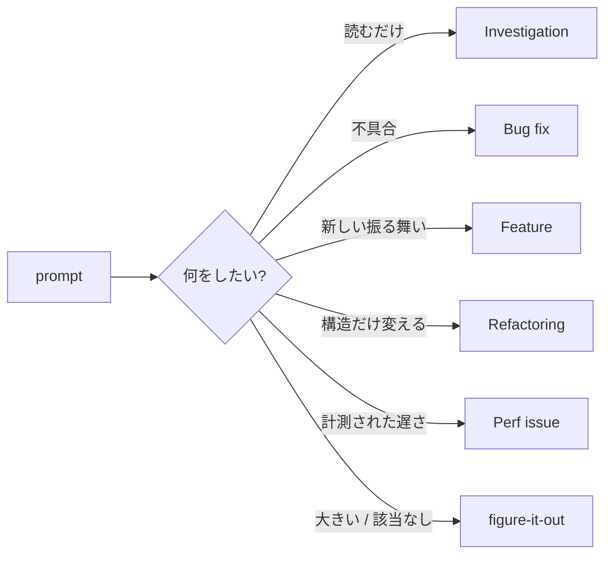

「new task」と言えば、前のプレイブックを引きずらずに再照合する

---

## 開発の流れに沿ったスキル配置

<div class="diagram">
  <div class="node">Understand<small>how / why / teach / recall</small></div>
  <div class="arrow">→</div>
  <div class="node">Design<small>architect / arena / swarm</small></div>
  <div class="arrow">→</div>
  <div class="node">Build<small>tdd / unslop / no-comments</small></div>
  <div class="arrow">→</div>
  <div class="node">Verify<small>interrogate / blast-radius</small></div>
  <div class="arrow">→</div>
  <div class="node">Ship<small>babysit / shipping</small></div>
</div>

---

## 全スキルマップ（34スキル + 24原則）

| 段階 | スキル |
| --- | --- |
| 入口・案内 | `/poteto-mode` `/poteto-help` `/setup-pstack` |
| 頼み方を磨く | `/sharpen` `/in-your-own-words` `/bro` |
| 理解する | `/how` `/why` `/teach` `/recall` `/ketchup` `/ketchup-video` |
| 設計する | `/architect` `/arena` `/swarm` `/interrogate` `/figure-it-out` |
| 作る・磨く | `/tdd` `/unslop` `/no-comments` `/technical-writing` `/typescript-best-practices` |
| 検証する | `/blast-radius` `/benchmark-checklist` `/create-verification-skill` `/maintain-verification-skill` `/create-formal-verification-skill` `/maintain-formal-verification-skill` `/statechart` |
| 記録・改善 | `/show-me-your-work` `/reflect` `/correct` `/automate-me` |
| 道具 | `/make-bot-ui` |

---

## Prompt：頼む前に問いを磨く

依頼文そのものが浅いと、どれだけ厳密に実行しても浅い成果になる

<div class="diagram">
  <div class="node">/sharpen<small>依頼を「大きく」でなく「深く」する</small></div>
  <div class="arrow">+</div>
  <div class="node">/in-your-own-words<small>ゴールと問題を言い直させる</small></div>
  <div class="arrow">+</div>
  <div class="node">/bro<small>直前の返答を平易な言葉で言い直す</small></div>
  <div class="arrow">+</div>
  <div class="node">/poteto-help<small>どのスキルを使うか聞く</small></div>
</div>

- 誤読は言い直しの段階で見つかる。コードを書く前なら、直すのはメッセージ1通で済む

---

## `/sharpen`：その道のプロなら何をするか

作業はせず、プロンプトだけを書き直して返す

1. この分野のトッププロなら、頼まれていなくても **何をするか**
2. 加工済みの情報ではなく、どの **一次素材** から始めるか
3. どんな **手法と道具** を使うか
4. あなたでもエージェントでもない、何が **結果の正しさを示すか**

```text
/sharpen write a migration guide for the v2 config format.
```

書き直したプロンプトには「実験で決まる選択はプロトタイプで決めて推奨を出す」が入り、好みや製品判断だけが人間に残る

---

## Understand：触る前に理解する

| スキル | 答えるもの |
| --- | --- |
| `/how` | このサブシステムは **どう動いているか** |
| `/why` | なぜこう作られたか。コードではなくコミットや PR 議論から答え、推測は推測と明記する |
| `/teach` | how と why を編み込み、図を積み上げながら説明する |
| `/recall` | 自分のチャット履歴から、トピックの現状を短いブリーフに戻す |

---

## `/why`：コードではなく「記録」から答える

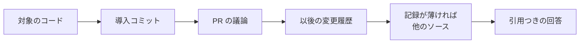

- 作者が書いたことを引用し、自分の推測は推測と明記する
- 記録から答えられないことは「答えられない」と書く
- 実行時の振る舞いは `/how`、設計判断の理由は `/why` と役割を分ける

---

## `/recall`：自分の作業文脈を復元する

作業を始める前、または再開する前に、いま何がどうなっているかを短くまとめる

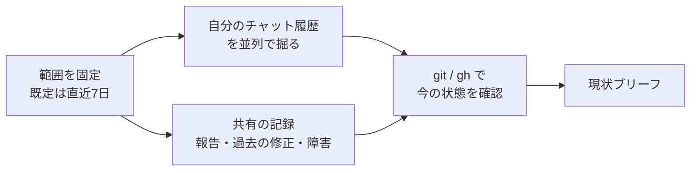

- 履歴の読み込みは安いモデルのサブエージェントに分散させる
- 特定のチャットを引き継ぐなら Session pickup プレイブックを使う

---

## `/ketchup`：留守中の変化に追いつく

最後のメッセージ以降に何が変わったかを、平易な言葉と小さな図で伝える

| ルール | 中身 |
| --- | --- |
| 何が起きたか | 100語以内。ユーザーにとって何が変わったかだけ |
| 図 | スクリーンショット、動画、Mermaid。箱は6個まで |
| 判断待ち | 1項目約30語。返信だけで決められる材料と、エージェントの推奨を添える |
| 読み取り専用 | このターンではコードも変えず、ジョブも起動しない |

`/ketchup-video` は同じ内容を字幕つきのスライド動画にする

---

## Design：最初の案を採用しない

<div class="quote-panel">よくある設計ミスは2つ。エージェントの最初の案を採ること。コードで試していない計画を磨き続けること。</div>

- 計画はコードで行う。プロトタイプで未決の問いに答え、文章の計画は最後
- 実験で決着がつく分岐は、人に聞かずにプロトタイプを作って観察する
- 製品判断や好みの判断だけを人間に残す

---

## `/architect`：境界を先に決める

関数の境界をまたぐコードを書く前に、呼び出し側から形を決める

1. 変更が触るシステムをすべて辿る
2. 型・シグネチャ・モジュール境界を持つ **2つの異なる形** をスケッチする
3. 次の基準で選ぶ
   - 各状態の **持ち主が1人**
   - 各タスクの **やり方が1つ**
   - 呼び出し側が知るべきことが **最も少ない**

同じワークアラウンドが繰り返されたら、パッチではなく再設計する

---

## `/arena`：同じ課題を N 体に解かせる

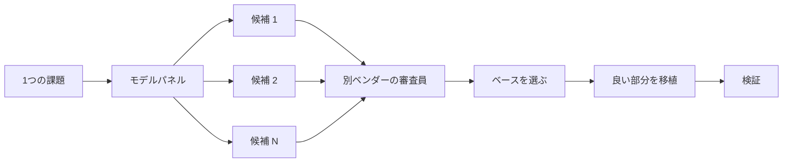

各候補は自分専用の worktree で作業し、互いに干渉しない

---

## `/swarm` と `/arena` の違い

| | `/arena` | `/swarm` |
| --- | --- | --- |
| 各ワーカーへの指示 | 全員 **同じ** 課題 | それぞれ **別の** 範囲 |
| 目的 | 設計の質を上げる | 網羅性・速度を上げる |
| 結果のまとめ方 | ベース選定 + 移植 | PASS / ISSUES / BLOCKED の集約レポート |
| 向く場面 | キャッシュキー設計などの重い判断 | 全パッケージの check.sh 実行 |

---

## `/interrogate`：壊しに来る敵を用意する

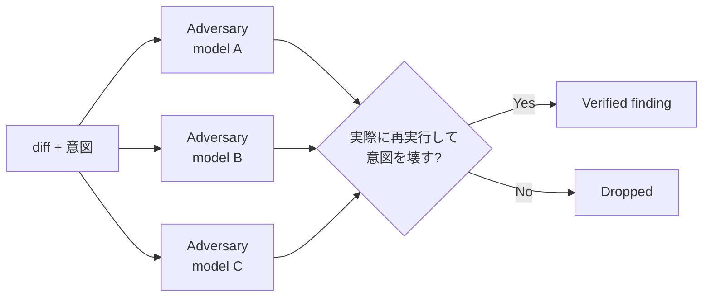

指摘は **実行で再現できたものだけ** 残る。Dropped 一覧も読み、判断は人間が上書きできる

---

## Build：書いたあとに削る

<div class="matrix">
  <div><h4>/tdd</h4><p>安く回せるテスト経路があるなら、失敗するテストを先に書いてから直す。</p></div>
  <div><h4>/unslop</h4><p>文章から AI っぽい癖を取り除く。返答・PR 説明も対象。</p></div>
  <div><h4>/no-comments</h4><p>Comment Sicko エージェントがコメントを削る。残すべき制約は型やチェックに置き換える提案をする。</p></div>
  <div><h4>/technical-writing</h4><p>Diátaxis + Google style + STE の多層標準でドキュメントを書く。</p></div>
</div>

---

## `/unslop`：AIっぽい文章の癖を消す

番号つきのルールで、ほかのスキルからも参照される

| # | ルール |
| --- | --- |
| 7 | additionally, crucial, delve, pivotal などの AI 語彙を使わない |
| 9 | 「X だけでなく Y も」をやめ、言いたいことを書く |
| 10 | 無理に3つ組にしない |
| 13 | ダッシュを使わない。句点か読点で切る |
| 22 | 「素晴らしい質問です」のような同意から始めない |
| 26 | substrate, flywheel, north star などの抽象メタファーを使わない |
| 27 | 気分ではなく、仕組みや数字を書く |

返答、PR 説明、コミットメッセージ、判断ログまで全部に適用される

---

## `/no-comments` と型の規律

<div class="diagram">
  <div class="node">diff<small>コメントつき</small></div>
  <div class="arrow">→</div>
  <div class="node">Comment Sicko<small>コメントを削る指摘</small></div>
  <div class="arrow">→</div>
  <div class="node">受け入れた指摘を修正</div>
  <div class="arrow">→</div>
  <div class="node">制約は構造へ<small>型・assert・lint に置き換え</small></div>
</div>

- コメントで「ここは null にならない」と書くより、型でそう表す
- `/typescript-best-practices` は `.ts` / `.tsx` を触るとき、Type System Discipline を具体的な構文に落とす

---

## Verify：「コンパイルが通った」は証拠ではない

変更の種類ごとに、本物の成果物で確かめる

| 変更 | 確かめ方 |
| --- | --- |
| CLI | 実際のコマンドを実行する |
| UI | 動いているアプリで変更したフローを歩く |
| パーサ・移行 | 保存した入力をリプレイする |
| 性能 | 修正前後のプロファイルを比べる |
| ストレージ | 書いた値を読み戻す |

確認できなかったら「inconclusive」と言う。証拠のない自信満々の返答は危険信号

---

## 数字を疑う：`/benchmark-checklist`

速くなった、という数字ほど偶然に騙されやすい

1. この数字を制限しているものは何か。なぜ2倍ではないのか
2. 両側とも本番と同じチューニングで動いたか
3. ディスク帯域やコア数など、物理的な限界を超えていないか
4. エラーや誤出力はなかったか
5. 交互に何度も回して、中央値と幅で再現するか
6. ユーザーが待つ経路で、エンドツーエンドに効いているか
7. 計測区間の中で、本当にその処理が走ったか

---

## `/blast-radius`：変更が他で何を壊すか

呼び出し元を並べることが仕事ではない。grep で見えない壊れ方を探す

<div class="timeline">
  <div class="step"><strong>1. 言った</strong><span>それだけでは無価値</span></div>
  <div class="step"><strong>2. 指した</strong><span>実在する file:line</span></div>
  <div class="step"><strong>3. 示した</strong><span>失敗経路が届かないと辿った</span></div>
  <div class="step"><strong>4. 動かした</strong><span>本物のコードを呼ぶスクリプト</span></div>
  <div class="step"><strong>5. 再現した</strong><span>動いているアプリで</span></div>
</div>

- 安全性を支える **ひとつの事実** を見つけ、それをどの段階まで証明できたかを書く
- 証明できなければ「unproven」と書く。もっともらしい説明文には価値がない

---

## 検証をプロジェクトの資産にする

<div class="diagram">
  <div class="node">create-verification-skill<small>アプリの起動と操作方法を調べる</small></div>
  <div class="arrow">→</div>
  <div class="node">project verify skill<small>feature map + 証拠の取り方</small></div>
  <div class="arrow">→</div>
  <div class="node">maintain-verification-skill<small>アプリとのズレを直す</small></div>
</div>

- 検証は多くの場合、人間待ちで一番遅い工程になる
- エージェントが自分で検証できれば、人間はボトルネックでなくなる
- テストで届かないレースや状態機械は `/create-formal-verification-skill` で形式検証する

---

## 形式検証：テストが届かない場所へ

レース、リトライ、状態機械、パーサ、unsafe コードは、テストでは壊れるケースに届きにくい

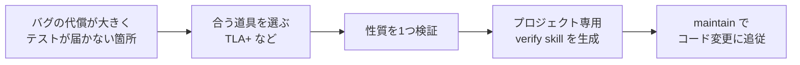

- `maintain-formal-verification-skill` は、失敗が「検証側のズレ」か「コードのバグ」かを区別して報告する

---

## `/statechart`：振る舞いを「見せる」

仕様を読まない人にも、状態遷移の図でバグを示す

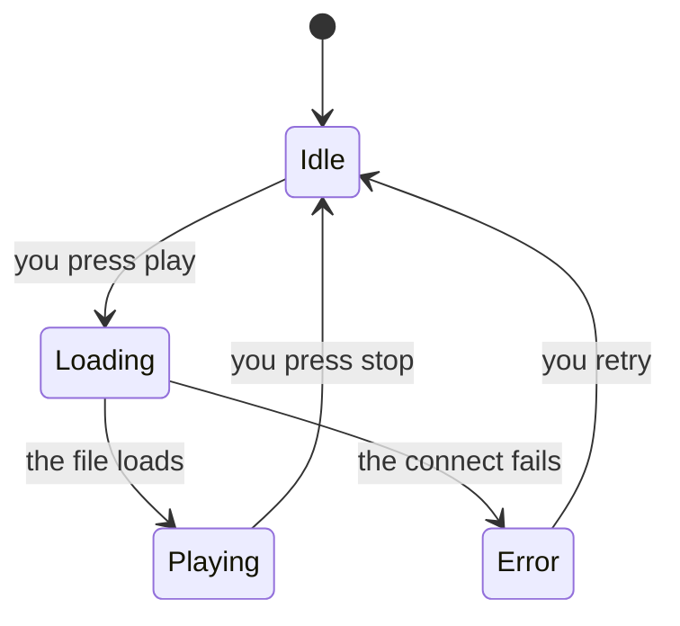

- TLA+ のモデルを TLC で検査し、Mermaid の状態図として描く
- 読み手が合意したルールを INVARIANT にし、破れた状態には印をつけ、そこへの **最短経路** を示す
- ラベルは変数名ではなく「再生ボタンを押す」のように読み手の言葉で書く

---

## 寝ている間に走らせる

```text
/poteto-mode im going to bed. migrate every caller to the new parser
in a fresh worktree off <base>.
done means zero old callers, all parser fixtures pass, old api deleted.
keep a decision log. don't ask me before committing.
/loop until done. if you're truly stuck after a few hours, stop and write up why.
```

| 一文 | 効果 |
| --- | --- |
| going to bed | 確認を止めて進み続けるセッション上書き |
| done means ... | 毎回実行できる完了チェック |
| fresh worktree | 他の作業と衝突しない |
| decision log | 朝に監査できる判断の記録 |
| stop and write up why | 8時間の「創造的なゴール再解釈」を防ぐ脱出口 |

---

## 夜間ループの中身

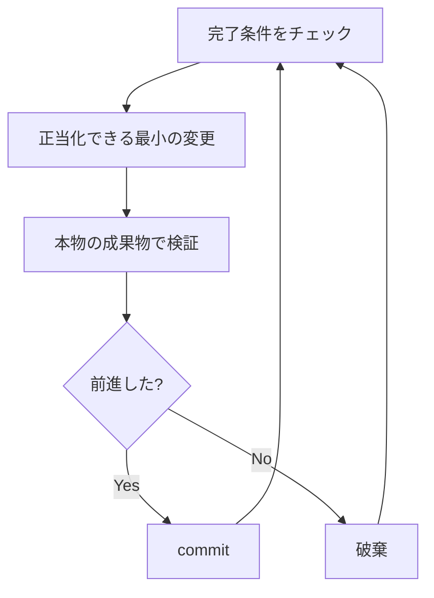

ループを自律にする前に「一度手でやった」「道具が揃った」「各段で止められる」「失敗を道具に変えた」の4つを満たす

---

## `/figure-it-out`：プレイブックがなければ設計する

<div class="timeline">
  <div class="step"><strong>A. Frame</strong><span>完了条件を反証可能な述語にし、規模と厳密さを決める</span></div>
  <div class="step"><strong>B. Design</strong><span>独立して入る単位に分け、未知の大きいものから並べる</span></div>
  <div class="step"><strong>C. Loop</strong><span>仮説 → 最小変更 → 計測 → 採用か revert</span></div>
  <div class="step"><strong>D. Trail</strong><span>判断ログを残す</span></div>
  <div class="step"><strong>E. Verify</strong><span>本物の製品で述語を確かめる</span></div>
</div>

- 検証の仕組みは作業より先に作り、変更前のベースラインを取る
- 判定は VERIFIED / NOT VERIFIED / INCONCLUSIVE。INCONCLUSIVE は合格ではない

---

## `/show-me-your-work`：判断ログを TSV で残す

```text
ts         phase    decision                     why                    evidence             result
09:40:00Z  harness  変更前のスクショを撮った     新旧を比べるため        scripts/snapshot.sh  120枚保存
11:15:00Z  widget   見た目を変えずにスタイル移行  差分を小さく保つため    commit 7c21e0a       pixel-diff 0
12:30:00Z  widget   ヘルパーの成果を捨てた        スクショが真っ白だった  worktree reset       reverted
```

- 1行1判断。証拠は文章ではなく、コミット・`file:line`・成果物へのポインタ
- 追記のみ。間違えた行は消さず、上書きする新しい行を足す
- 最後に、作業したのとは **別ベンダーのモデル** がログとトランスクリプトを突き合わせる

---

## 自律性の線引き

<div class="matrix">
  <div><h4>Just do it</h4><p>可逆な作業や、チャット投稿・チケット更新は聞かずに進める。</p></div>
  <div><h4>Always pause</h4><p>共有ブランチへの force-push、デプロイ、データ削除、顧客への連絡。</p></div>
  <div><h4>Session override</h4><p>「寝る」「止まるな」「終わるまで」で、聞かずに最後まで進む。</p></div>
  <div><h4>No is OK</h4><p>聞かれたら本音で答える。同意はデフォルトではない。</p></div>
</div>

---

## 24の原則

poteto-mode は毎タスクの最初に原則のインデックスを読み、該当するものを適用する

| 群 | 何を決めるか | 代表 |
| --- | --- | --- |
| Core (10) | どれだけ作るか、いつ考え直すか | Laziness Protocol |
| Architecture (6) | 状態・検証・互換性をどこに置くか | Boundary Discipline |
| Verification (5) | 何を証拠とみなすか | Prove It Works |
| Delegation (2) | 並列作業をどう正気に保つか | Guard the Context Window |
| Meta (1) | 学びをどう残すか | Encode Lessons in Structure |

---

## 原則は「名前で操縦する」ための語彙

ユーザーが原則を呼び出すのではなく、名前で軌道修正する

```text
use subtract before you add. delete the obsolete adapters first,
then design what's left.
```

```text
apply prove it works. run the real import flow and show me the written records.
```

- 名前の裏に、エージェントが既に読んだ具体的なルールがある
- 一言で、段落ぶんの指示より正確に方向を変えられる
- 返答では「どの原則が、どの判断を変えたか」を必ず書く。判断を伴わない引用は適用していない証拠

---

## Core：作る量を減らす原則

<div class="matrix">
  <div><h4>Laziness Protocol</h4><p>削除と、問題を解く最小の変更を優先する。</p></div>
  <div><h4>Subtract Before You Add</h4><p>足す前に、不要なものを先に取り除く。</p></div>
  <div><h4>Foundational Thinking</h4><p>ロジックより先に、中心のデータ構造を決める。</p></div>
  <div><h4>Redesign from First Principles</h4><p>新要件は、最初からあったかのように設計し直して組み込む。</p></div>
</div>

ほかに Attack the Premise / Minimize Reader Load / Outcome-Oriented Execution / Experience First / Exhaust the Design Space / Build the Lever

---

## Attack the Premise

同じ前提に立った修正が2回失敗したら、3回目を書く前に前提を疑う

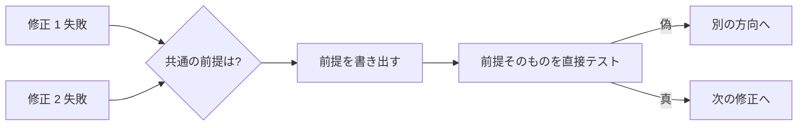

---

## Architecture：状態と境界の原則

| 原則 | ひとことで |
| --- | --- |
| Model the Domain | 散らばった条件分岐ではなく、状態機械・型・テーブルで表す |
| Boundary Discipline | 検証は境界で行い、内部の型は信頼する |
| Type System Discipline | 不正な状態を表現できないようにする |
| Make Operations Idempotent | リトライやクラッシュがあっても同じ終状態に収束させる |
| Migrate Callers Then Delete | 新 API への移行と旧 API の削除を同じ波でやる |
| Separate Before Serializing | ロックを足す前に、共有そのものをなくす |

---

## Separate Before Serializing Shared State

並列エージェントが同じブランチを書くなら、調停より先に分離する

<div class="diagram">
  <div class="node">共有ブランチ<small>ロック・順番待ち・衝突</small></div>
  <div class="arrow">✕</div>
  <div class="node">worktree A<small>エージェント A</small></div>
  <div class="arrow">+</div>
  <div class="node">worktree B<small>エージェント B</small></div>
  <div class="arrow">+</div>
  <div class="node">cloud VM<small>エージェント C</small></div>
</div>

arena の各候補、Opening a PR、並列タスクがすべて worktree 前提になっているのはこの原則のため

---

## Verification と Delegation の原則

<div class="matrix">
  <div><h4>Prove It Works</h4><p>代理指標ではなく、本物の成果物で確かめる。</p></div>
  <div><h4>Fix Root Causes</h4><p>症状から、最初にシステムが壊れた場所まで辿って直す。</p></div>
  <div><h4>Explain the Number</h4><p>数字を信じる前に、何がそれを制限しているかを言う。</p></div>
  <div><h4>Guard the Context Window</h4><p>大量の読み込みはサブエージェントへ。本線には要約だけ残す。</p></div>
</div>

ほかに Sequence Work into Verifiable Units / Test Behavior, Not Implementation / Never Block on the Human

---

## Build the Lever と Encode Lessons in Structure

「手でやる」を「再実行できる道具」に変える

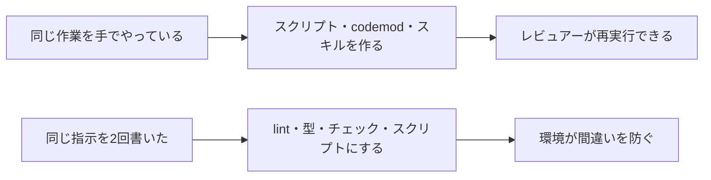

- 同じ手順を毎回同じようにできるならスクリプトに任せ、エージェントは判断に使う
- `/correct` は履歴から繰り返す間違いを掘り出し、アーキテクチャ → 型・lint・CI → テスト → ドキュメントの順で、なるべく強い層に固定する

---

## サブエージェントの設計

| エージェント | 役割 |
| --- | --- |
| `poteto-agent` | プレイブック内で委譲するコード作業の担当。起動直後に `worker.md` と poteto-mode の SKILL.md を全部読む |
| `comment-sicko` | コメントを嫌い、削除を楽しむレビュアー。ワークアラウンドのコードを糾弾する |

- 委譲のたびに新しいエージェントを起動し、文脈の汚染を避ける
- 汎用エージェントで代用すると原則を読まずにドリフトする
- 役割ごとにモデルと推論予算を `/setup-pstack` で設定する

---

## マルチモデルの使い方

モデルを1つに決めず、役割で分ける

<div class="diagram">
  <div class="node">実装・文章・判断<small>既定は Opus 5.5 xhigh</small></div>
  <div class="arrow">+</div>
  <div class="node">審査パネル<small>Fable / Opus / Gemini</small></div>
  <div class="arrow">+</div>
  <div class="node">エスカレーション<small>同じ課題で2回失敗したら上位モデル</small></div>
</div>

- 審査員は候補と **別ベンダー** のモデルにして、同じ癖で見逃さない
- 設定は Claude Code なら `~/.claude/rules/pstack-models.md` に書き出される

---

## `/correct`：同じ間違いを二度とさせない

前提：エージェントは開いたファイルしか見ず、近くの例を真似し、コンパイルが通る最短経路を取る

<div class="timeline">
  <div class="step"><strong>1. Architecture</strong><span>状態の持ち主を1つに。間違った import が失敗する構造に</span></div>
  <div class="step"><strong>2. Types / Lint / CI</strong><span>悪い状態を書けなくする。エラー文に正解を書く</span></div>
  <div class="step"><strong>3. Tests</strong><span>振る舞いが壊れたら落ちるテストに直す</span></div>
  <div class="step"><strong>4. Docs</strong><span>判断が要るものだけ。最後の手段</span></div>
</div>

- 2回起きたら「クラス」とみなす。新しいチェックは過去の実際の間違いで落ちることを証明する

---

## 自分の働き方をスキルにする

| スキル | 何をするか |
| --- | --- |
| `/automate-me` | 自分の実際の作業履歴から、自分専用の `-mode` スキルを書き起こす |
| `/reflect` | 長いタスクが終わったら、トランスクリプトから学びを掘り、既存スキルへの具体的な編集にする |
| `/setup-pstack` | 使えるモデルを検出し、役割ごとのモデルと推論予算をルールファイルに書く |
| `/make-bot-ui` | Webhook でボットを起こすボタンつきのページやダッシュボードを作り、Tailscale で公開する |

pstack 自体も「フォークして育てる」前提で作られている

---

## 自分のものにする

<div class="timeline">
  <div class="step"><strong>/poteto-help</strong><span>どのスキルを使うか迷ったら聞く</span></div>
  <div class="step"><strong>/automate-me</strong><span>自分の働き方から自分専用の mode を作る</span></div>
  <div class="step"><strong>/correct</strong><span>繰り返す間違いを構造で防ぐ</span></div>
  <div class="step"><strong>/reflect</strong><span>終わったタスクのレシピをスキルに残す</span></div>
</div>

スキルの変更は Eval プレイブックで、ブラインドでエージェントの振る舞いを比べてから入れる

---

## 設計思想のまとめ

<div class="matrix">
  <div><h4>深さ → 信頼 → 並列</h4><p>1体を信頼できるまで深くしてから、並列と夜間実行に広げる。</p></div>
  <div><h4>証拠で語る</h4><p>完了は実行結果で示す。指摘も、再現できたものだけが残る。</p></div>
  <div><h4>引き算が先</h4><p>削除、最小差分、コメント削除。書かないことが品質になる。</p></div>
  <div><h4>構造に刻む</h4><p>原則・プレイブック・lint・スクリプトに落として、毎回の注意力に頼らない。</p></div>
</div>

---

## 明日から試すなら

1. `/setup-pstack` でモデルと推論予算を選ぶ
2. 次のバグ修正を `/poteto-mode ... repro first, then fix and verify.` で頼む
3. 返ってきた証拠と、引用された原則を読む
4. 気になったら原則の名前で軌道修正する

<div class="quote-panel">ゴールと、それを確かめる方法を、自分の言葉で渡す。</div>

---

## 参考

- pstack README と pstack guide（`cursor/plugins` リポジトリ）
- [poteto（作者）](https://x.com/poteto)
- Claude Code での導入：`/plugin marketplace add cursor/plugins` → `/plugin install pstack@cursor-plugins`
